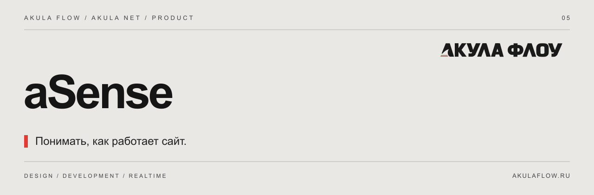

[Сайт](https://akulaflow.ru/) · [GitHub](https://github.com/yanakulov/asense) · [GitVerse](https://gitverse.ru/yanakulov/asense) · [Changelog](CHANGELOG.md)

# aSense · Чутьё Акулы

**Подробная аналитика, цели и поведение посетителей.**

Часть экосистемы [Akula Net](https://github.com/yanakulov/anet) от [Акулы Флоу](https://akulaflow.ru/). Работает с общей авторизацией и пользователями aNet.

## Возможности

- Приватный Umami и PostgreSQL.
- Источники трафика и UTM-кампании.
- Цели, воронки и отчёты.
- Выборочно включаемые записи сессий и тепловые карты.
- Изоляция аналитики по клиенту и разрешённому домену.

## Подключение

Подключаемый модуль aNet. ID лицензии: `analytics`. Расширенный сбор включается отдельно от базового обзора aCore.

Для работы требуется aCore и серверное разрешение на модуль.

## Версия

Описание соответствует текущей aNet **1.2.0**. Отдельная версия aSense не заявляется. Совместимые пакеты AF — **0.2.0**.

## Другие части экосистемы

[aCore](https://github.com/yanakulov/acore) · [aVision](https://github.com/yanakulov/avision) · [aFlow](https://github.com/yanakulov/aflow) · [aJaws](https://github.com/yanakulov/ajaws)

## О репозитории

Это публичный информационный репозиторий: описание продукта и журнал изменений. Исходники развиваются в приватных репозиториях. Публикация описания не предоставляет лицензию на программное обеспечение.

Сайт и связь со студией: [akulaflow.ru](https://akulaflow.ru/).
